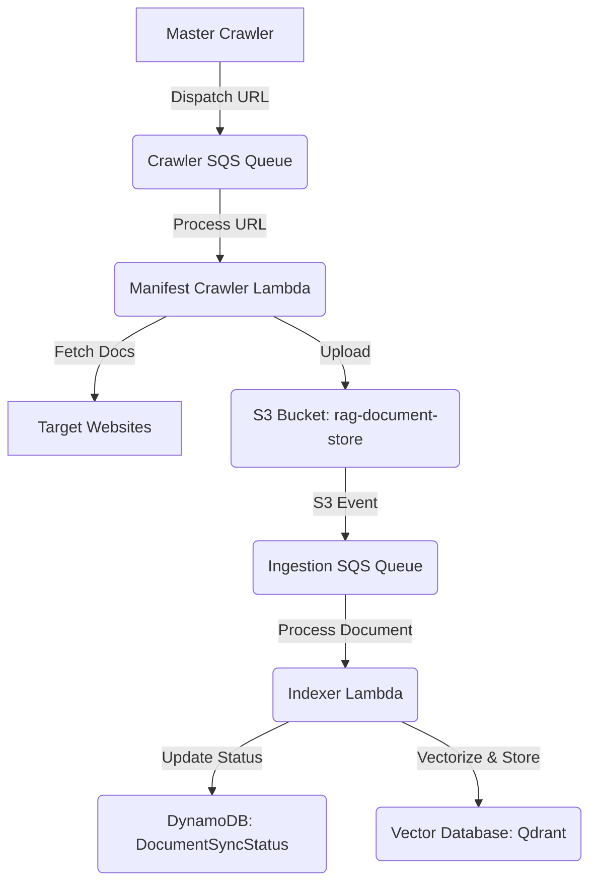

# Infrastructure Architecture

The system uses [Pulumi](https://www.pulumi.com/) to manage AWS infrastructure as code using Python. This ensures that infrastructure state is version-controlled, reproducible, and tightly coupled with the application's lifecycle.

## Overview

The infrastructure codebase is located in the `/infra/` directory. The primary entry point for the Pulumi program is `__main__.py`, which declares essential AWS resources including storage, messaging, and database components. The architecture is designed as a serverless, event-driven pipeline for document ingestion and indexing.

### Request and Data Flow

The following diagram illustrates the high-level flow from crawling to vector indexing.



## Infrastructure Components

The infrastructure includes several core AWS services:

*   **DynamoDB Table (`DocumentSyncStatus`):** Tracks the ingestion status of documents using `doc_id` as the hash key, ensuring idempotency during the pipeline execution.
*   **S3 Bucket (`rag-document-store`):** The primary staging area for raw ingested documents before processing.
*   **SQS Queues:** 
    *   **Crawler Queue:** Manages crawl job dispatches. Configured with a 300s visibility timeout and a Dead-Letter Queue (DLQ) to handle retries.
    *   **Ingestion Queue:** Processes documents uploaded to S3. Configured with a 900s visibility timeout and a Dead-Letter Queue (DLQ) to ensure resilient processing of intensive indexing tasks.
*   **Vector Database:** Integration with a managed or self-hosted Qdrant instance for efficient semantic search and RAG retrieval.

## Environment Management

Environments are managed using Pulumi stacks, which correspond to configuration files (e.g., `Pulumi.dev.yaml`). Each stack maintains its own infrastructure state, allowing for isolated deployments across development, staging, or production environments. 

To manage infrastructure, navigate to the `/infra/` directory:

```bash
cd /infra/
```

### Pulumi Commands

- **Preview changes:** Review proposed changes against the current state.
  ```bash
  pulumi preview
  ```
- **Deploy infrastructure:** Apply the current `__main__.py` definitions to the configured AWS environment.
  ```bash
  pulumi up
  ```
- **Destroy infrastructure:** Remove all resources managed by the current stack.
  ```bash
  pulumi destroy
  ```

## Extending Infrastructure

To add or modify resources, update `/infra/__main__.py`:

1.  **Define:** Use the Pulumi AWS Python SDK.
2.  **Tagging:** Always apply consistent tags (e.g., `{"Environment": "dev", "Project": "rag-ingestion"}`) to ensure cost tracking and resource management.
3.  **Validate:** Run `pulumi preview` to verify that the changes meet the desired state before applying.
