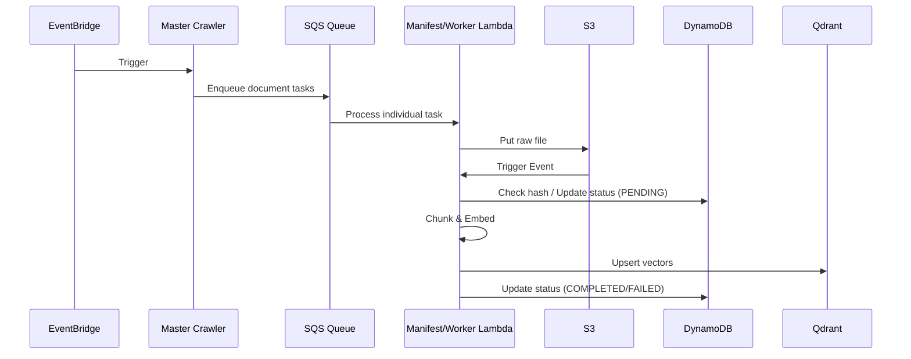

# Ingestion Pipeline

The Ingestion Pipeline is a scalable, event-driven serverless system designed to crawl, process, and embed documents for the RAG platform. By leveraging AWS serverless services, the architecture achieves high concurrency and cost efficiency.

## Overview

The pipeline automates the lifecycle of document ingestion, from URL discovery to vector database insertion. It is designed to minimize database load through manifest-based deduplication and ensure high performance by decoupling heavy dependencies.

## Ingestion Flow

The ingestion pipeline follows a highly asynchronous, event-driven architecture. The flow initiates when a new document is detected, progresses through a queue-based fan-out, and ends with persistent storage in the vector database and status tracking in DynamoDB.

## Core Workflow

### 1. Dispatch
The process begins with an **EventBridge Scheduler** trigger. The `master_crawl_handler` identifies target URLs and pushes individual tasks onto the `rag-crawler-queue` (SQS). This fan-out pattern enables parallel execution and improves fault tolerance.

### 2. Crawl and Processing
The `manifest_crawl_handler` consumes messages from the SQS queue:
*   **Deduplication:** The worker performs a hash check against the existing record in **DynamoDB** to determine if the content has changed, ensuring only necessary updates are processed.
*   **State Management:** Throughout the pipeline, the document status is maintained in DynamoDB (transitioning from `PENDING` to `COMPLETED` or `FAILED`).

### 3. Transformation and Embedding
An S3 event notification triggers the worker Lambda when new files are persisted:
*   **Transformation:** The worker fetches raw content, generates text chunks using custom splitters, and invokes Amazon Bedrock to create embeddings.
*   **Persistence:** Embeddings and metadata are indexed into Qdrant. Finally, the DynamoDB status is updated to reflect the completion of the ingestion task.

## Key Architectural Principles

*   **Decoupling Dependencies:** To optimize for speed and size, heavy libraries (such as LangChain and FastEmbed) are excluded. Lightweight alternatives and direct REST API calls are used instead.
*   **Cost Efficiency:** By utilizing S3 manifests for deduplication, the system significantly reduces DynamoDB read operations, which are a primary cost driver in high-volume ingestion.
*   **Resilience:** The use of SQS with a Dead-Letter Queue (DLQ) ensures that failed ingestion tasks are isolated and do not block the pipeline.

## Related Documentation

*   **[Ingestion Service](../services/ingestion.md):** Detailed implementation breakdown of the Lambda functions and code modules.
*   **[ADR 0001: SQS Fan-Out and S3 Manifest Deduplication](../../docs/adr/0001-manifest-crawler-sqs-fanout.md)**
*   **[ADR 0002: Decoupled Ingestion Dependencies](../../docs/adr/0002-decouple-ingestion-dependencies.md)**
