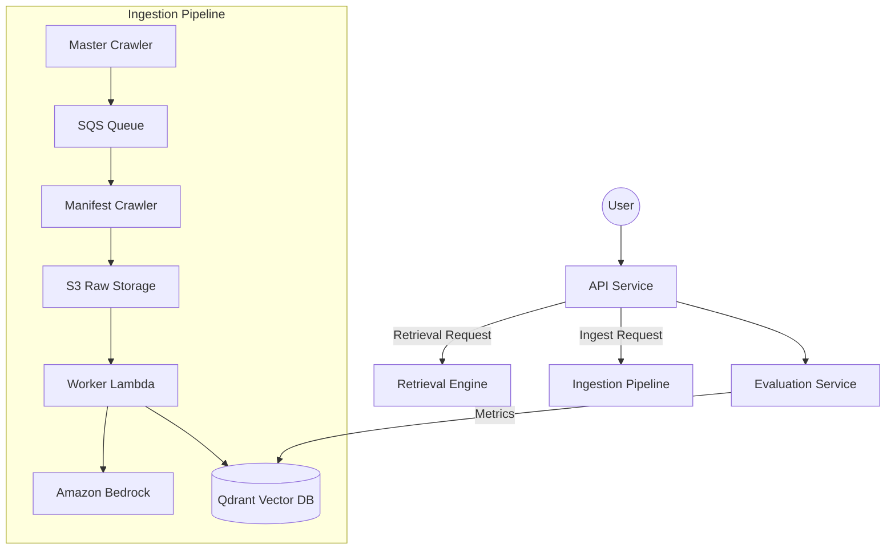

# System Architecture Overview

This document provides a conceptual overview of the RAG (Retrieval-Augmented Generation) platform. The system is designed as a modular, event-driven serverless architecture that separates data ingestion from retrieval and evaluation.

## High-Level System Architecture

The system consists of three primary domains: the **Ingestion Pipeline** for data lifecycle management, the **API Service** for user-facing query interactions, and the **Evaluation Service** for quality assurance.

## Core Components

### API Service
The API Service acts as the primary orchestration layer. It exposes REST endpoints for users to trigger ingestion tasks, submit queries for retrieval, and initiate evaluation workflows. It manages the control plane for the application.

### Ingestion Pipeline
The ingestion pipeline is an automated, event-driven process that transforms raw external content into searchable vector embeddings.

*   **Dispatch:** Uses EventBridge and a Master Crawler to identify source material and orchestrate large-scale crawls.
*   **Crawling:** The Manifest Crawler manages source discovery and performs lightweight deduplication via S3-stored state manifests, avoiding unnecessary database lookups.
*   **Processing:** An S3-based trigger initiates the Worker Lambda, which handles text chunking and embedding generation.
*   **Persistence:** Embeddings and metadata are persisted into a Qdrant vector database, while ingestion job status is tracked in DynamoDB.

### Evaluation Service
The Evaluation Service provides a feedback loop by assessing retrieved context and generated responses. It runs against established benchmarks and stores performance metrics to inform model and retrieval configuration tuning.

## Key Design Principles

*   **Event-Driven & Decoupled:** Components communicate primarily through asynchronous event triggers (SQS, S3 Events), allowing for horizontal scaling and fault isolation.
*   **Minimalist Dependency Footprint:** To optimize Lambda performance and cold-start latency, the pipeline avoids heavy frameworks, opting for lightweight custom integrations.
*   **Cost Efficiency:** Leverages serverless native features (like S3 manifests for deduplication) to minimize expensive database operations during high-throughput tasks.
*   **Fault Tolerance:** The use of SQS and DLQs ensures that failed ingestion tasks can be safely retried without manual intervention.
