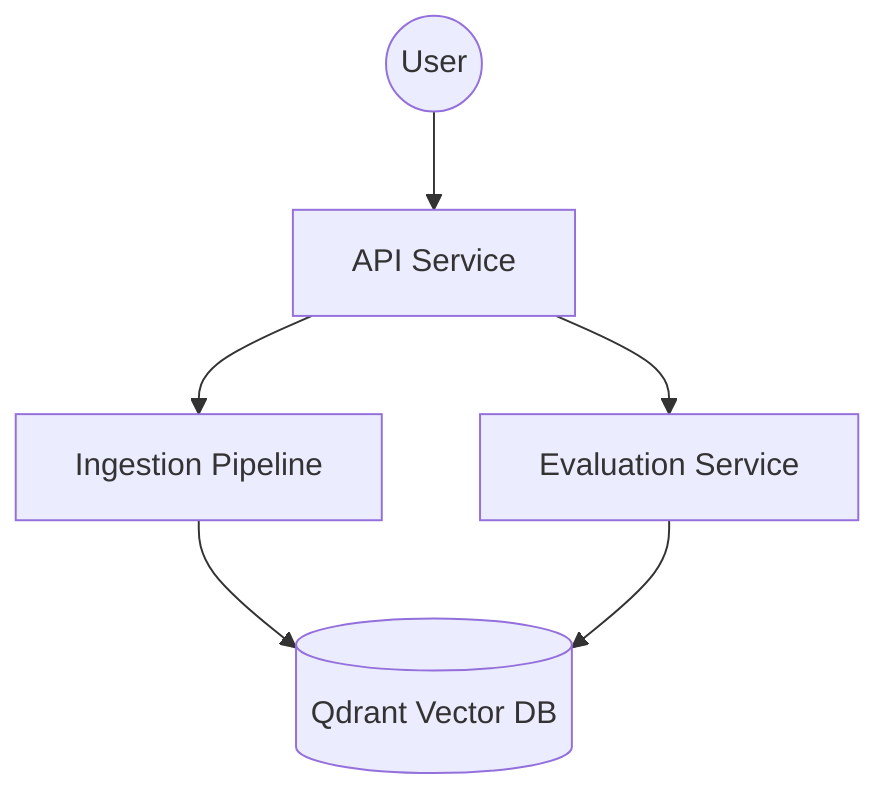
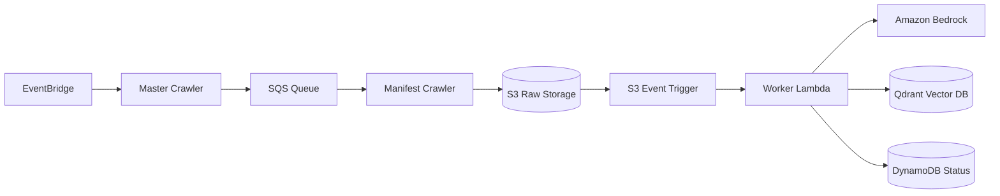

# System Overview

This document provides a high-level architectural overview of the serverless RAG (Retrieval-Augmented Generation) platform. The system is designed to ingest, process, and evaluate external knowledge, providing a scalable and cost-effective interface for RAG applications.

## Core Architecture

The system is composed of three primary subsystems:

1.  **[API Service](api-service.md):** Acts as the unified entrypoint for client requests. It coordinates RAG queries, triggers manual ingestion, and exposes the evaluation service functionality.
2.  **[Ingestion Pipeline](ingestion-pipeline.md):** A robust, event-driven pipeline responsible for crawling, chunking, embedding, and storing source content into a vector database.
3.  **Evaluation Service:** Assesses retrieval performance and generation quality using configured benchmarks.

## Ingestion Architecture

The ingestion pipeline is engineered for efficiency and scale, utilizing an event-driven flow to maintain a current and searchable knowledge base.

### Key Mechanisms

*   **Crawling & Fan-out:** The system uses EventBridge to schedule crawls. The **Master Crawler** dispatches URLs to an SQS queue, allowing for parallel, distributed crawling via the **Manifest Crawler**.
*   **Cost-Optimized Deduplication:** Instead of costly database lookups, the pipeline performs lightweight deduplication against state manifests stored in S3.
*   **Decoupled Processing:** The pipeline minimizes Lambda cold-starts and memory usage by avoiding bulky dependencies. It employs custom lightweight text splitters and performs direct REST integrations.
*   **Vector Search Offloading:** To maintain speed, the system offloads intensive vector operations and sparse vector generation directly to the Qdrant server, keeping the worker logic lean.

## Operational Design Principles

*   **Fault Tolerance:** SQS provides reliable buffering between crawling and processing stages, while Dead-Letter Queues (DLQ) capture failed jobs for inspection.
*   **Serverless Efficiency:** Resources are strictly demand-driven, aligning costs with ingestion volume and request patterns.
*   **Extensibility:** Component boundaries are defined to allow for independent scaling and replacement of specific services, such as swapping embedding models or vector databases.

See [Infrastructure](infrastructure.md) for details on the underlying deployment and cloud resource management.
