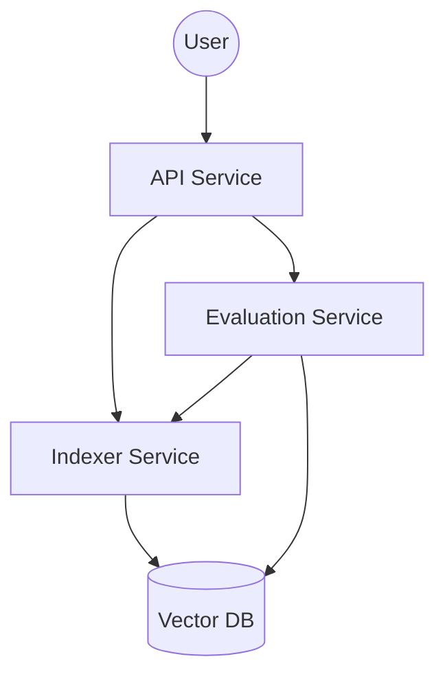
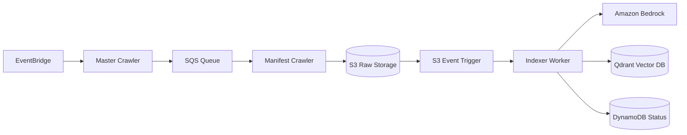

# System Architecture Overview

This document provides a high-level model of the RAG platform's architecture. The system comprises three primary subsystems: the API Service, the Ingestion Pipeline (powered by the Indexer Service), and the Evaluation Service.

## High-Level Communication Flow

The system components interact as follows:

*System component interaction diagram.*

## Component Responsibilities

*   **API Service:** Acts as the primary entrypoint for users, exposing endpoints for document ingestion, retrieval, and evaluation requests.
*   **Indexer Service:** Manages the ingestion pipeline, orchestrating crawling, document processing, and vector storage updates in Qdrant.
*   **Evaluation Service:** Assesses retrieval and generation quality by querying the vector database and invoking the indexer for benchmarking tasks.

## Data Lifecycle and Control Flow

The platform relies on an event-driven flow for document ingestion, managed primarily by the Indexer Service.

*Ingestion lifecycle flow managed by the Indexer Service.*

### Subsystem Details

*   **Indexer Service Orchestration:** The Indexer uses a fan-out pattern starting with an EventBridge trigger, followed by crawling and deduplication against S3 manifests. The Worker Lambda performs chunking and embedding before final persistence in Qdrant.
*   **API Service Coordination:** The API service acts as a mediator, receiving user commands and delegating heavy lifting to either the Indexer (for document operations) or the Evaluation Service (for benchmarking).
*   **Evaluation Service Interaction:** The Evaluation service performs read-only access to the Vector DB and can trigger re-indexing or status updates via the Indexer Service.

## Architectural Design Principles

The platform's design is driven by the following core priorities:

*   **Decoupled Services:** Services interact via defined interfaces, allowing independent scaling and deployment.
*   **Event-Driven Pipeline:** The Indexer Service relies on asynchronous queues (SQS) to manage throughput and ensure fault tolerance.
*   **Optimized Storage:** Usage of S3-based manifests and Qdrant ensures efficient handling of vector data and metadata.
*   **Minimalist Dependency Footprint:** Services avoid bloated libraries to minimize cold-starts and runtime overhead.
